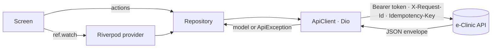

# e-Clinic Mobile

Flutter apps for **e-Clinic**, a clinic management system: a **patient app** for visits, results and invoices, and a
**staff app** for the day at the clinic — schedule, check-in by QR code, treatment sessions, approvals and clocking in.

Both apps talk to the same REST API as the web client and share one set of packages, so a feature looks and behaves
the same everywhere.

| | |
|---|---|
| **Platforms** | Android 8+ · iOS 15.5+ |
| **Stack** | Flutter 3.32+ (Dart 3.8+) · Riverpod 3 · go_router · Dio · freezed + json_serializable · Material 3 |
| **Backend** | [e_clinic_server](https://github.com/HussainALAradi5/e_clinic_server) (Laravel, REST JSON, Sanctum tokens) |
| **Web client** | [e_clinic_client](https://github.com/HussainALAradi5/e_clinic_client) (Angular) |
| **Documentation** | [e_clinic_documentation](https://github.com/HussainALAradi5/e_clinic_documentation) → `mobile/` |

---

## The apps

### Patient app — `apps/patient`

| Screen | What patients do |
|---|---|
| **Home** | The next visit as a ticket with its check-in QR code; one line per area with what is waiting |
| **Visits** | Upcoming and past visits; cancel (with a reason, up to 2 hours before) |
| **Book a visit** | New problem or follow-up → doctor → day → free time; the clinic confirms it |
| **Treatments** | Plans with a progress bar coloured by how they are going, the next session, and each session's status |
| **Results** | Completed tests and scans with the report and their files |
| **Prescriptions** | How to take each medicine; open ones carry the pharmacy code |
| **Invoices** | Issued invoices with what is left to pay, their lines and payments |
| **Messages · Profile** | In-app notifications; contact details and emergency contact |

### Staff app — `apps/staff`

Tabs appear only when the user's role has the matching right; Today and More are there for everyone.

| Tab | Who | What it does |
|---|---|---|
| **Today** | All staff | Clock in / out · today's bookings by stage (*expected → waiting → with doctor → done*) with the next step on each card · *Late* after 10 minutes and *Waiting N min* after check-in · *Mine / All* for the front desk · refreshes every 30 seconds |
| **Scan** | Front desk, nurses, doctors, pharmacy | Camera (or typed code) → a booking with **Check in**, a patient card with today's bookings, or any signed record's key facts |
| **Sessions** | Therapists, doctors | My treatment sessions for today and the week ahead · **Start** / **Complete** |
| **Approvals** | Accountant, HR, admin | Pending refunds, expenses, leave and overtime · **Approve** / **Reject** with a reason · leave over booked days asks before cancelling them |
| **More** | All staff | Account, clock page, password & security, sign out |

Action buttons follow each booking's `allowed_transitions` from the server *and* the user's permissions — the server
checks both again on every call. A patient account that signs in to the staff app is sent to the patient app.

### Shared by both

- Sign-in with email and password, **two-step code** for roles that need it, password reset by emailed code
- **Biometric app lock** after time in the background (patient 5 min, staff 2 min)
- Light and dark themes in the clinic's brand colours; coloured status badges for every enum, labelled by the server
- Coming back to the page you were on after a reload, an unlock or a deep link

---

## How the code is organised

One [pub workspace](https://dart.dev/tools/pub/workspaces) — a single `flutter pub get` at the root resolves everything.

```text
e_clinic_mobile/
├── apps/
│   ├── patient/        Patient app: router, bottom-tab shell, portal screens
│   └── staff/          Staff app: router, permission-aware tabs, screens, actions
├── packages/
│   ├── core/           AppConfig, Dio client + interceptors, ApiException & error codes,
│   │                   ListQuery filter grammar, token storage, permission expressions,
│   │                   clinic clock (Asia/Bahrain), money in fils
│   ├── data/           freezed models (snake_case on the wire) and repositories —
│   │                   one method per endpoint
│   ├── ui/             Theme and widget kit
│   └── features/       Shared sign-in: login, two-step code, password reset, app lock,
│                       password & security, auth routing
└── tools/
    └── patch_platforms.dart   Adds internet, biometric, camera and dev-HTTP settings
                               to the generated Android / iOS folders
```



### Widget kit (`packages/ui`)

| Widget | Use |
|---|---|
| `AppButton` | The only button for server actions: locks on tap, spinner, success tick, optional confirm sheet and a `before` step (ask a reason first — the spinner covers only the call) |
| `StatusChip` | Coloured badge for any enum value; label always written |
| `InfiniteList` · `AsyncBody` · `SkeletonList` · `EmptyState` · `ErrorState` | Lists and loading / empty / error states |
| `FactList` · `SectionHeader` · `ExpandableCard` | Label–value rows, headings, cards that open in place |
| `GreetingHeader` · `ProfileHeader` · `LinkGroup` / `LinkTile` · `InfoNote` | Page headers, link lists, hints |
| `ChipBar` · `DateBlock` · `DayChip` / `DayStrip` | Choice chips with counts, date blocks, day pickers |
| `showConfirmSheet` · `showReasonSheet` · `showCodeSheet` · `AppSnack` | Sheets, QR codes, messages with the request reference |

---

## Getting started

### Requirements

- Flutter **3.32 or newer** (Dart 3.8+)
- Android Studio or Xcode for a device / emulator
- A running [e_clinic_server](https://github.com/HussainALAradi5/e_clinic_server) (see its README; `php artisan migrate:fresh --seed` loads demo data)

### First run

```bash
git clone https://github.com/HussainALAradi5/e_clinic_mobile.git
cd e_clinic_mobile
flutter pub get

# Generate the models (*.freezed.dart / *.g.dart) — again after changing a model.
cd packages/data && dart run build_runner build && cd ../..

# Android / iOS folders for each app (keeps the existing lib/ and test/), then the platform settings.
cd apps/patient && flutter create --platforms=android,ios --org bh.clinic --project-name e_clinic_patient . && cd ../..
dart run tools/patch_platforms.dart apps/patient
cd apps/staff && flutter create --platforms=android,ios --org bh.clinic --project-name e_clinic_staff . && cd ../..
dart run tools/patch_platforms.dart apps/staff
```

The staff app's scanner (`mobile_scanner`) needs Android `minSdkVersion` 21+ and iOS 15.5+; if `flutter create` set
lower values, raise them in `apps/staff/android/app/build.gradle(.kts)` and `apps/staff/ios/Podfile`.

### Run against your local server

```bash
# In e_clinic_server:  php artisan serve        →  http://127.0.0.1:8000
cd apps/staff          # or apps/patient
flutter run                                                         # Android emulator → http://10.0.2.2:8000/api/v1
flutter run --dart-define=API_URL=http://127.0.0.1:8000/api/v1      # iOS simulator
flutter run --dart-define=API_URL=http://192.168.1.20:8000/api/v1   # phone on the same Wi-Fi
                                                                    # (serve with --host=0.0.0.0)
```

### Demo accounts (local seed data only)

The server's demo seeder creates these accounts on non-production installs; the password and the fixed two-step code
are listed in `DEMO_USERS.md` of the documentation repository.

| App | Account | Try |
|---|---|---|
| Patient | `patient@demo.eclinic.bh` | Home ticket, booking, results, prescriptions, invoices |
| Staff | `reception@demo.eclinic.bh` | Today (clinic schedule), Scan & check-in |
| Staff | `nurse@demo.eclinic.bh` | Sessions, start / complete |
| Staff | `accountant@demo.eclinic.bh` · `hr@demo.eclinic.bh` | Approvals (two-step code) |

Clocking in works only from the clinic network (`HR_CHECK_IN_NETWORKS` on the server; a local install accepts any
private address).

---

## Quality checks

```bash
flutter analyze                                   # lints: flutter_lints + strict casts / raw types
flutter test packages/core apps/patient apps/staff
```

Tests cover the permission-expression parser, the filter grammar, money and clinic dates, the API base URL, which
staff tabs and visit steps a role gets, and the late / waiting rules.

## Conventions

- **Screens never call Dio.** Data comes from `ref.watch(provider)`, actions from repositories; failures arrive as
  `ApiException`, whose `code` is the server's stable `error_code` — switch on it, never on the message.
- **Every server action is an `AppButton`**: it locks on tap, shows progress and reports errors with the request
  reference. Throw `ActionCancelled` to stop quietly.
- **Money stays a string** (`"25.500"`); sums use fils. Dates are clinic dates (`ClinicClock`, Asia/Bahrain).
- **Filters use the server grammar**: `AllOf([Where.oneOf('status', [...]), Where.gte('scheduledDate', today)])`.
- **Bookings send an `Idempotency-Key`**; a failed attempt gets a fresh one.
- **Nothing medical is stored on the phone**; the token lives in the Keychain / Keystore only.
- Riverpod providers are written by hand; models use freezed. Generated files are not committed.

## Roadmap

- Staff app: patient files, calendar and booking, X-ray / lab work list with camera uploads, dispensing with barcode
  scan, leave requests, offline cache, clinic geofence on clock-in
- Push notifications (Firebase / APNs), deep links, screenshot protection on medical screens, certificate pinning
- Setting up two-step sign-in from the phone (signing in with a code works today)
