# e-Clinic Mobile

[](https://github.com/HussainALAradi5/e_clinic_mobile/actions/workflows/tests.yml) [](LICENSE)

**One Flutter app** for **e-Clinic**, a clinic management system. After sign-in it shows what fits the account:
**patients** get their visits, results and invoices; **staff** get their day at the clinic — schedule, check-in by
QR code, treatment sessions, approvals, patient files, booking, the order work list, the pharmacy and their own leave.
One app, one store listing, one build — the same approach as
the web client, where staff pages and the patient portal also live in one app.

It talks to the same REST API as the web client, so a feature looks and behaves the same everywhere.

**Screenshots:** taken on a real phone, light and dark, for each role — [below](#screenshots).

## Live demo

| | Address |
|---|---|
| Web app (staff and patient portal) | https://e-clinic-web.onrender.com |
| API | https://e-clinic-api.onrender.com |

Free Render instances sleep when idle: the first visit can take about a minute to wake the API. Demo accounts
(one per role: patient, receptionist, doctor, nurse, pharmacist, cashier, accountant, HR, admin) are available on
request.

The phone app is not in a store yet; build it with `--dart-define=API_URL=https://e-clinic-api.onrender.com`
to use the live API.

| | |
|---|---|
| **Platforms** | Android 8+ · iOS 15.5+ |
| **Stack** | Flutter 3.32+ (Dart 3.8+) · Riverpod 3 · go_router · Dio · freezed + json_serializable · Material 3 |
| **Backend** | [e_clinic_server](https://github.com/HussainALAradi5/e_clinic_server) (Laravel, REST JSON, Sanctum tokens) |
| **Web client** | [e_clinic_client](https://github.com/HussainALAradi5/e_clinic_client) (Angular) |
| **Documentation** | Technical documentation (screens, widgets, controllers) — available on request |

---

## What it does

### For patients

| Screen | What patients do |
|---|---|
| **Home** | The next visit as a ticket with its check-in QR code; one line per area with what is waiting |
| **Visits** | Upcoming and past visits; cancel (with a reason, up to 2 hours before) |
| **Book a visit** | New problem or follow-up → doctor → day → free time; the clinic confirms it |
| **Treatments** | Plans with a progress bar coloured by how they are going, the next session, and each session's status |
| **Results** | Completed tests and scans with the report and their files |
| **Prescriptions** | How to take each medicine; open ones carry the pharmacy code |
| **Invoices** | Issued invoices with what is left to pay, their lines and payments |
| **Messages · Profile** | In-app notifications; contact details and emergency contact |

### For staff

Tabs appear only when the user's role has the matching right; Today and More are there for everyone.

| Tab | Who | What it does |
|---|---|---|
| **Today** | All staff | Clock in / out · today's bookings by stage (*expected → waiting → with doctor → done*) with the next step on each card · *Late* after 10 minutes and *Waiting N min* after check-in · *Mine / All* for the front desk · refreshes every 30 seconds |
| **Scan** | Front desk, nurses, doctors, pharmacy | Camera (or typed code) → a booking with **Check in**, a patient card with today's bookings, or any signed record's key facts |
| **Sessions** | Therapists, doctors | My treatment sessions for today and the week ahead · **Start** / **Complete** |
| **Approvals** | Accountant, HR, admin | Pending refunds, expenses, leave and overtime · **Approve** / **Reject** with a reason · leave over booked days asks before cancelling them |
| **More** | All staff | Account, the work pages below that the role may open, password & security, sign out |

Work pages opened from **More** (each follows its own right, also when opened by a link):

| Page | Who | What it does |
|---|---|---|
| **Patient files** | Front desk, doctors, nurses, pharmacy | Search by name, file number or mobile · allergies first, details, insurance, coming visits and history · **Book a visit** |
| **Calendar & booking** | Front desk, doctors, nurses | A day by provider, two weeks ahead · booking wizard: patient → kind of visit → provider → day → free time → desk or phone |
| **Order work list** | Doctors, nurses | Open X-ray, scan, lab, ECG and referral orders, urgent first · **Start**, **Write result** (flag abnormal), **Add result photo**, **Cancel** with a reason |
| **Pharmacy queue** | Pharmacists | Prescriptions still to hand over · owed quantities preselected, − / + per medicine, **scan each pack** to check it is the prescribed medicine, a witness for controlled drugs · **Dispense** (stock out first-expiry-first, added to the invoice) |
| **Dispensed medicines** | Pharmacy | What left the pharmacy, with batches · **Cancel** returns the stock and reverses the charge |
| **My leave** | All staff | Days left per leave type · **Request leave** (half day for one day) · photo of the certificate on a sick-leave draft, then **Send** · withdraw |
| **Clock in / out** | Staff with attendance | Today's shift and times · sends the phone's position, so it works off the clinic network inside the clinic geofence |

Action buttons follow each booking's `allowed_transitions` from the server *and* the user's permissions — the server
checks both again on every call. Patients never reach staff screens, nor staff the patient screens.

### For everyone

- Sign-in with email and password, **two-step code** for roles that need it, password reset by emailed code
- **Two-step sign-in set-up** from the phone: open the authenticator app (or copy the key), type the first code,
  keep the recovery codes; turn it off with the password where the role allows
- **Biometric app lock** after time in the background (patient 5 min, staff 2 min)
- **No screenshots** in release builds on Android (`FLAG_SECURE`): medical screens never end up in the gallery or
  recent-apps list (debug builds allow them, for the documentation)
- **Deep links** `eclinic://app/<page>` (e.g. `eclinic://app/clinic/appointments/<id>`), after sign-in and unlock
- **Offline**: staff still see today's schedule from an encrypted copy (wiped on sign-out), with actions off
- Light and dark themes in the clinic's brand colours; coloured status badges for every enum, labelled by the server
- Coming back to the page you were on after a reload, an unlock or a deep link

---

## How the code is organised

One [pub workspace](https://dart.dev/tools/pub/workspaces) — a single `flutter pub get` at the root resolves everything.

```text
e_clinic_mobile/
├── apps/
│   └── clinic/         The app: one router with a patient (portal) and a staff area
│       └── lib/src/        Layer-first, each layer split into portal / staff / common:
│           ├── config/routes/   Route paths (portal, staff — staff pages filtered by rights)
│           ├── controllers/     Riverpod providers and actions
│           ├── screens/         One screen per route
│           ├── widgets/         Screen parts, grouped by screen area
│           └── utilities/       Formatters, visit timing, dispense plan, clock location
├── packages/
│   ├── core/           config/ (AppConfig, providers), services/ (Dio ApiClient, ApiException,
│   │                   token storage), middlewares/ (interceptors), dtos/ (ListQuery, Page),
│   │                   constants/ (error codes), utilities/ (permission expressions,
│   │                   clinic clock Asia/Bahrain, money in fils, text)
│   ├── data/           freezed models (snake_case on the wire) and repositories —
│   │                   one method per endpoint
│   ├── ui/             Theme and widget kit
│   └── shell/          App shell shared by the apps: start-up (runClinicApp), sign-in, two-step
│                       code, password reset, app lock, password & security, appearance —
│                       controllers/, screens/, widgets/, config/routes/
└── tools/
    └── patch_platforms.dart   Adds internet, biometric, camera and dev-HTTP settings
                               to the generated Android / iOS folders
```

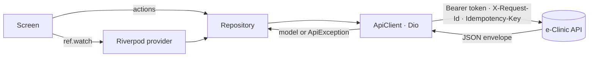

### Widget kit (`packages/ui`)

| Widget | Use |
|---|---|
| `AppButton` | The only button for server actions: locks on tap, spinner, success tick, optional confirm sheet and a `before` step (ask a reason first — the spinner covers only the call) |
| `StatusChip` | Coloured badge for any enum value; label always written |
| `InfiniteList` · `AsyncBody` · `SkeletonList` · `EmptyState` · `ErrorState` | Lists and loading / empty / error states |
| `FactList` · `SectionHeader` · `ExpandableCard` | Label–value rows, headings, cards that open in place |
| `GreetingHeader` · `ProfileHeader` · `LinkGroup` / `LinkTile` · `InfoNote` | Page headers, link lists, hints |
| `ChipBar` · `DateBlock` · `DayChip` / `DayStrip` | Choice chips with counts, date blocks, day pickers |
| `showConfirmSheet` · `showReasonSheet` · `showCodeSheet` · `AppSnack` | Sheets, QR codes, messages with the request reference |

---

<!-- hierarchy:start -->
## Hierarchy

### Packages

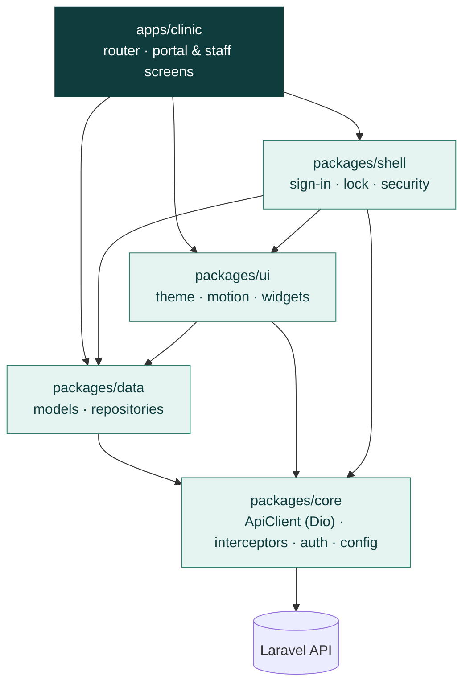

A package only uses the ones below it: `core` knows nothing of Flutter widgets, `data` nothing of screens.

### Screens

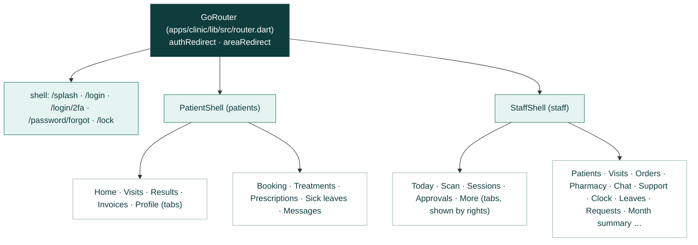

Signed out → sign-in; staff without the right for a screen → Today; both with an "Unauthorized access" message.

### How a screen reaches the API

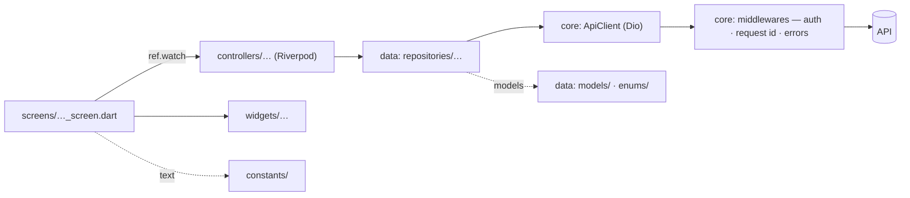

### Folders (package, then layer, then area)

```text
e_clinic_mobile/
├── apps/clinic/      243 files  ← the app: router, patient portal and staff area
│   ├── config/          4  route paths, app config  (routes)
│   ├── constants/      12  every screen text and limit  (billing · documents · portal · staff)
│   ├── controllers/    40  Riverpod providers and actions  (billing · portal · staff)
│   ├── screens/        72  one screen per route (+ part files)  (portal · staff)
│   ├── utilities/       4  formatters, visit timing, dispense plan  (staff)
│   └── widgets/       109  screen parts, grouped by area  (billing · common · portal · staff)
├── packages/shell/    34 files  ← start-up, sign-in, 2FA, lock, security, appearance
│   ├── config/          4  sign-in route paths and redirects  (routes)
│   ├── constants/       1  access-notice wording  (auth)
│   ├── controllers/     8  Riverpod providers and actions  (auth · settings)
│   ├── screens/        10  one screen per route (+ part files)  (auth)
│   ├── services/        2  access notices (Unauthorized access)  (auth)
│   └── widgets/         8  screen parts, grouped by area  (auth · settings)
├── packages/ui/       51 files  ← theme, motion and widget kit
│   ├── motion/          5  PopIn, TapScale, Nudge, progress bar
│   ├── theme/           5  light / dark theme, status colours
│   └── widgets/        41  the widget kit: buttons, lists, states, sheets, chips  (buttons · codes · dates · feedback · inputs · layout · lists · navigation · status)
├── packages/data/    121 files  ← models and repositories
│   ├── enums/          13  enums mirrored from the server  (billing · clinic · communication · documents · identity · shared)
│   ├── models/         74  freezed models (snake_case on the wire)  (billing · clinic · communication · documents · finance · hr · identity · pharmacy · shared)
│   ├── repositories/   33  one method per endpoint  (accounting · billing · clinic · communication · documents · finance · hr · identity · pharmacy)
│   └── utilities/       1  identity helpers  (identity)
└── packages/core/     23 files  ← API client, auth, config, utilities
    ├── config/          3  AppConfig and the shared providers
    ├── constants/       1  error codes
    ├── dtos/            8  ListQuery, Page — list request / response  (common)
    ├── middlewares/     3  Dio interceptors (auth, errors, request id)
    ├── services/        3  Dio ApiClient, ApiException, token storage  (api · auth)
    └── utilities/       5  permission expressions, clinic clock, money in fils  (access)
```
<!-- hierarchy:end -->

## Getting started

### Requirements

- Flutter **3.32 or newer** (Dart 3.8+)
- Android Studio or Xcode for a device / emulator
- A running [e_clinic_server](https://github.com/HussainALAradi5/e_clinic_server) (see its README; `php artisan migrate:fresh --seed` loads demo data)

### First run

```bash
git clone https://github.com/HussainALAradi5/e_clinic_mobile.git
cd e_clinic_mobile
flutter pub get

# Generate the models (*.freezed.dart / *.g.dart) — again after changing a model.
cd packages/data && dart run build_runner build && cd ../..

```

The Android and iOS folders are in the repository, already set up (internet, fingerprint / face unlock, camera for
the scanner, plain HTTP to a local server in debug builds — see `tools/patch_platforms.dart`).

### Run against your local server

```bash
# In e_clinic_server:  composer dev   (API on http://127.0.0.1:8000 plus the queue worker)
cd apps/clinic
flutter run                                                         # Android emulator → http://10.0.2.2:8000

# Real Android phone over USB: forward the phone's port 8000 to this computer, then use localhost.
adb reverse tcp:8000 tcp:8000
flutter run --dart-define=API_URL=http://127.0.0.1:8000

flutter run --dart-define=API_URL=http://127.0.0.1:8000      # iOS simulator
```

Against the live demo: `--dart-define=API_URL=https://e-clinic-api.onrender.com --dart-define=REVERB_KEY=e-clinic-live
--dart-define=REVERB_HOST=e-clinic-api.onrender.com --dart-define=REVERB_PORT=443 --dart-define=REVERB_SCHEME=https`.

Live chat updates (Online / Offline at once) need Reverb (`php artisan reverb:start --port=8085` in e_clinic_server)
and its address; without these the app polls:

```bash
adb reverse tcp:8085 tcp:8085
flutter run --dart-define=API_URL=http://127.0.0.1:8000 --dart-define=REVERB_KEY=<REVERB_APP_KEY>   --dart-define=REVERB_HOST=127.0.0.1 --dart-define=REVERB_PORT=8085 --dart-define=REVERB_SCHEME=http
```

### Icons and notification sounds

```bash
python tools/make_icons.py apps/clinic/android/app/src/main/res ../e_clinic_client/public    # needs Pillow
python tools/make_notification_sounds.py apps/clinic/android/app/src/main/res/raw ../e_clinic_client/public/sounds
```

The first draws the app icon (launcher, adaptive icon, web favicon) from the e-Clinic mark and one picture per kind
of notification (its colour and icon); the second makes one sound per kind.

### Demo accounts (local seed data only)

The server's demo seeder creates these accounts on non-production installs; the password and the fixed two-step code
are available on request.

| Area | Account | Try |
|---|---|---|
| Patient | `patient@demo.eclinic.bh` | Home ticket, booking, results, prescriptions, invoices |
| Staff | `reception@demo.eclinic.bh` | Today (clinic schedule), Scan & check-in |
| Staff | `nurse@demo.eclinic.bh` | Sessions, start / complete |
| Staff | `doctor@demo.eclinic.bh` | Patient files, calendar, order work list, my leave |
| Staff | `pharmacist@demo.eclinic.bh` | Pharmacy queue, dispense, dispensed medicines |
| Staff | `accountant@demo.eclinic.bh` · `hr@demo.eclinic.bh` | Approvals (two-step code) |

Clocking in works from the clinic network (`HR_CHECK_IN_NETWORKS` on the server; a local install accepts any
private address), or from the phone inside the clinic geofence once the server has `HR_CLINIC_LATITUDE` /
`HR_CLINIC_LONGITUDE` (radius `HR_CLINIC_RADIUS_METERS`, 150 m by default).

### Release build (Android)

A release build is signed with your own upload key. Create it once and keep it out of Git (`key.properties`,
`*.jks` and `*.keystore` are ignored):

```bash
cd apps/clinic/android
keytool -genkey -v -keystore upload-keystore.jks -keyalg RSA -keysize 2048 -validity 10000 -alias upload
```

Then add `apps/clinic/android/key.properties`:

```properties
storeFile=upload-keystore.jks
storePassword=<the keystore password>
keyAlias=upload
keyPassword=<the key password>
```

```bash
cd apps/clinic
flutter build appbundle --release --dart-define=API_URL=https://e-clinic-api.onrender.com   # Play Store
flutter build apk --release --dart-define=API_URL=https://e-clinic-api.onrender.com         # direct install
```

Without `key.properties` the release build falls back to the debug key, which is fine for `flutter run --release`
but not for publishing.

---

## Quality checks

```bash
flutter analyze                                   # lints: flutter_lints + strict casts / raw types
flutter test packages/core apps/clinic
```

Tests cover the permission-expression parser, the filter grammar, money and clinic dates, the API base URL, which
staff tabs, pages, visit and order steps a role gets, the late / waiting rules, the calendar grouping, what a
dispense sends (and when it needs a witness), and which area each account may open.

## Conventions

- **Screens never call Dio.** Data comes from `ref.watch(provider)`, actions from repositories; failures arrive as
  `ApiException`, whose `code` is the server's stable `error_code` — switch on it, never on the message.
- **Every server action is an `AppButton`**: it locks on tap, shows progress and reports errors with the request
  reference. Throw `ActionCancelled` to stop quietly.
- **Money stays a string** (`"25.500"`); sums use fils. Dates are clinic dates (`ClinicClock`, Asia/Bahrain).
- **Filters use the server grammar**: `AllOf([Where.oneOf('status', [...]), Where.gte('scheduledDate', today)])`.
- **Bookings send an `Idempotency-Key`**; a failed attempt gets a fresh one.
- **Nothing medical is stored on the phone**; the token lives in the Keychain / Keystore only.
- Riverpod providers are written by hand; models use freezed. Generated files are not committed.

## Roadmap

- Push notifications (Firebase / APNs): needs a free Firebase project and its config files
- `https://` App Links / Universal Links and certificate pinning: need the clinic's own domain
- An app-switcher privacy overlay on iOS (Android already blocks screenshots)

<!-- screenshots:start -->
## Screenshots

The main staff screens from a real Android phone with the demo data, in light and dark.

| Screen | Light | Dark |
|---|---|---|
| Today and filters | 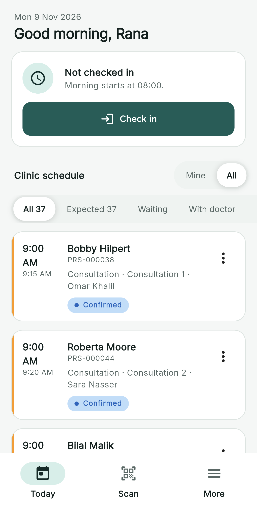 | 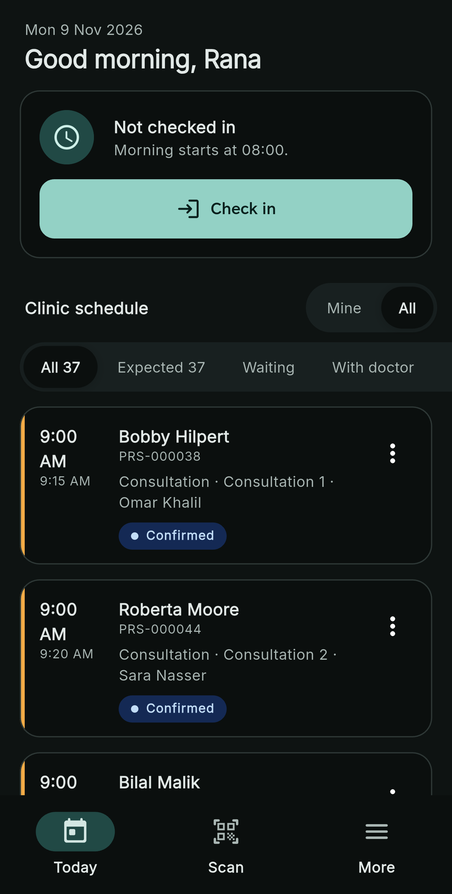 |
| Appointment with badges and event log | 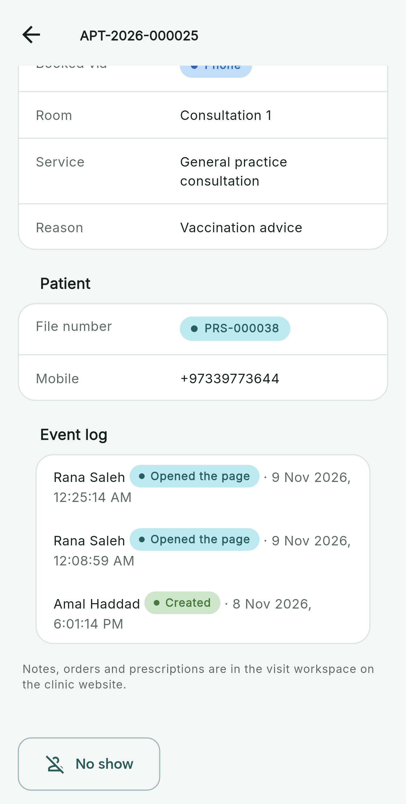 | 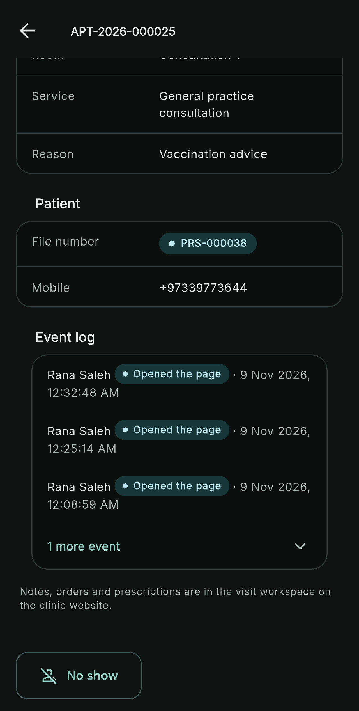 |
| Patient file event log | 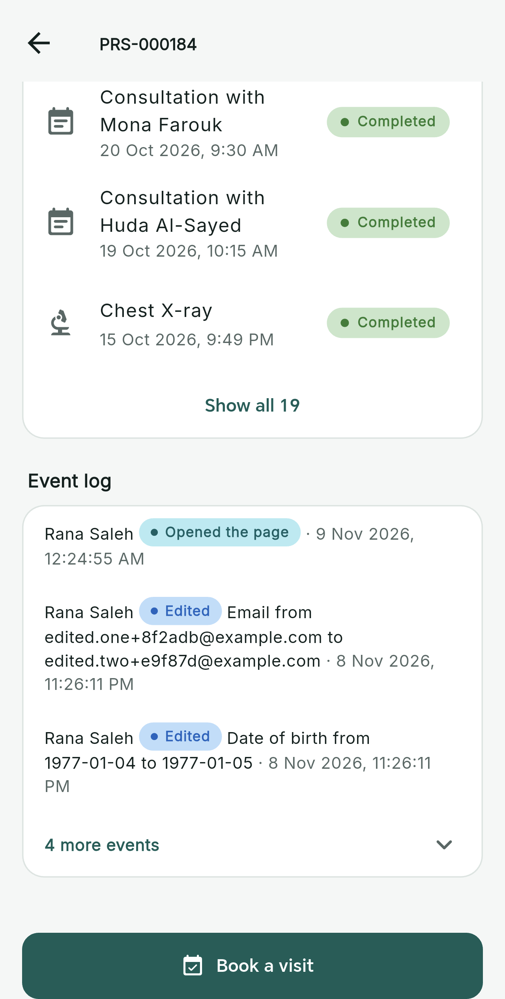 | 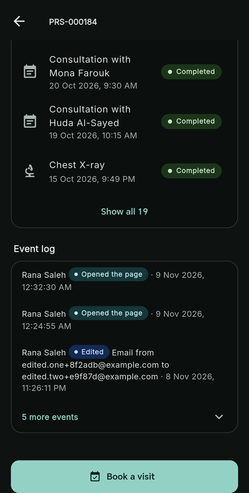 |
| More menu | 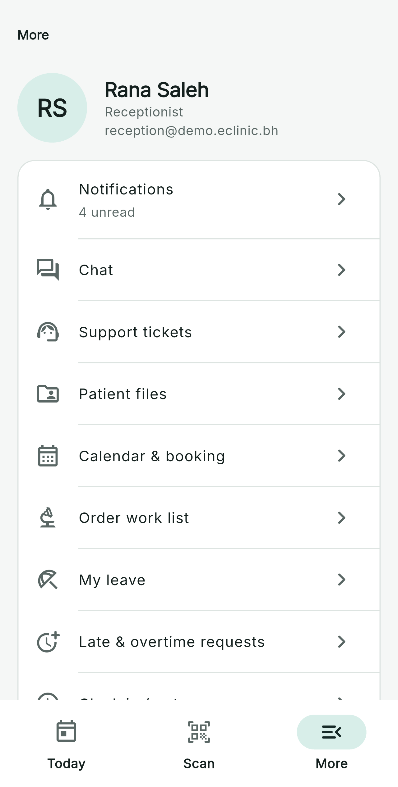 | 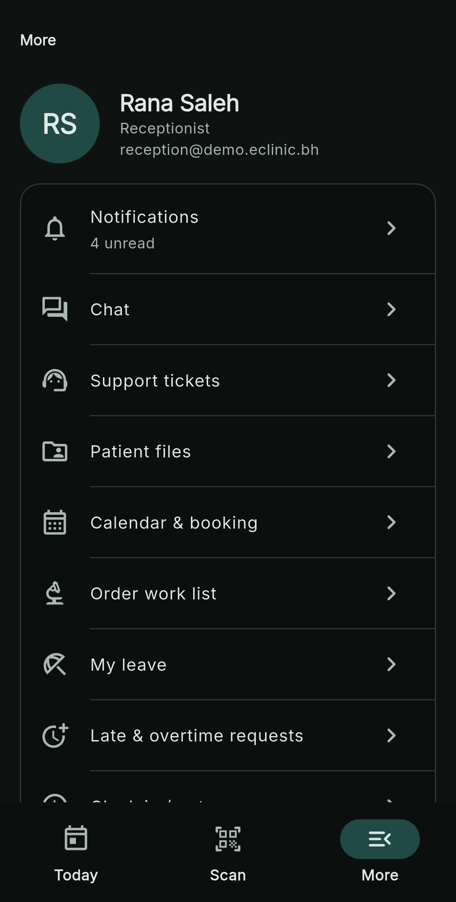 |

## Licence

[MIT](LICENSE)
